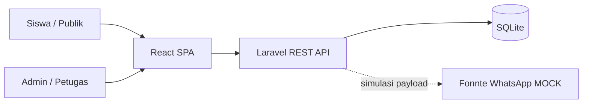
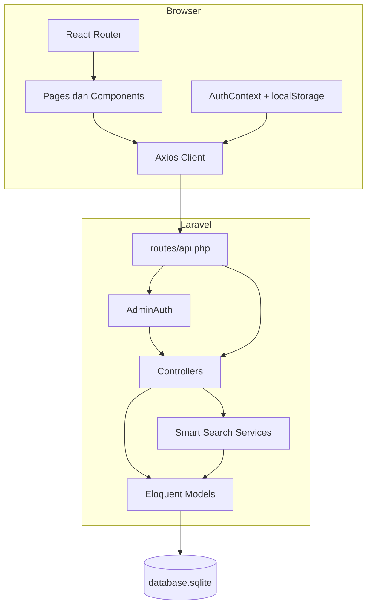
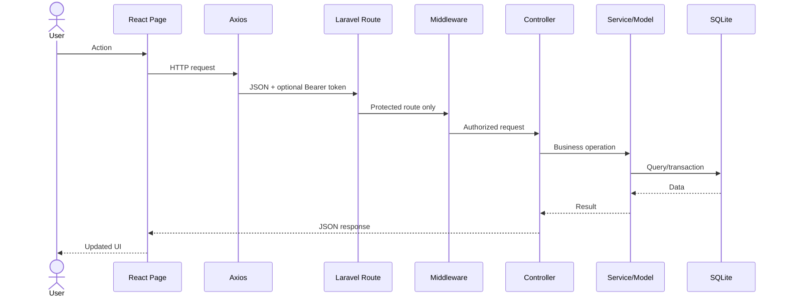
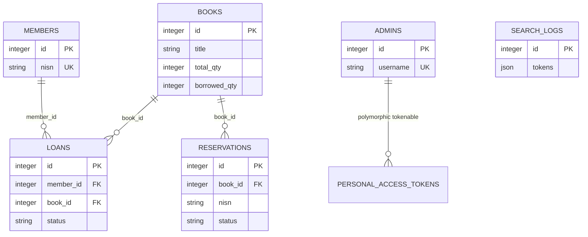
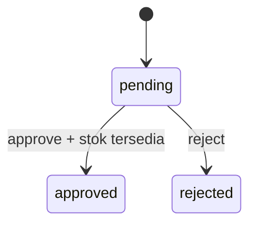
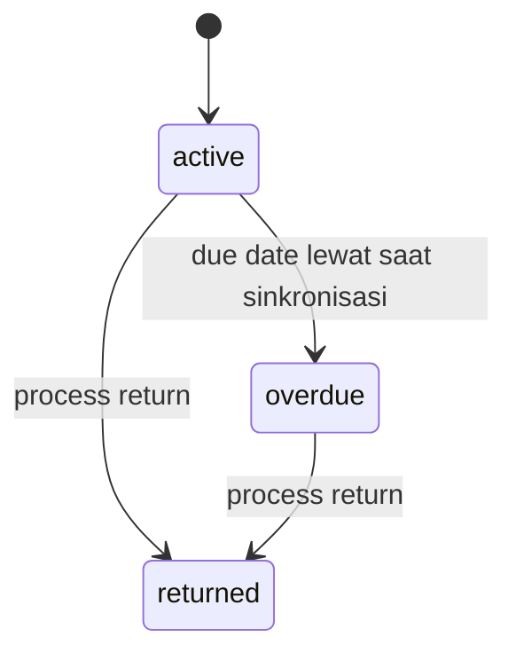

# Technical Master Context

## Software Engineering Handbook dan Sumber Teknis Otoritatif

**Project:** Implementation of Smart Search using Keyword Tokenization on a Web-Based Library System  
**Studi kasus:** Perpustakaan SDN Pulau Panggang  
**Tanggal audit:** 25 Juni 2026  
**Workspace:** `J:\webperpuscodexduaa`

> Dokumen ini memisahkan fakta implementasi, inferensi, mock, rencana, dan inkonsistensi. Klaim akademik sebaiknya mengikuti status yang diberikan di sini.

### Klasifikasi

- `FACT`: ditemukan langsung pada source code, konfigurasi, database, atau hasil eksekusi.
- `INFERENCE`: kesimpulan teknis yang masuk akal, tetapi tidak dinyatakan eksplisit oleh sistem.
- `DOCUMENTATION CLAIM`: tertulis di README atau UI, tetapi belum tentu ditegakkan implementasi.
- `IMPLEMENTED`: tersedia end-to-end pada frontend, API, dan persistence yang relevan.
- `PARTIAL`: sebagian tersedia atau memiliki aturan yang belum lengkap.
- `MOCK`: integrasi disimulasikan dan tidak menghubungi layanan eksternal.
- `PLANNED`: rencana masa depan, belum menjadi perilaku sistem.
- `UNUSED`: tersedia pada backend tetapi tidak dipanggil frontend aktif.
- `INCONSISTENCY`: dua sumber bukti menyatakan hal berbeda.

---

## 1. Executive Technical Overview

Sistem ini adalah aplikasi perpustakaan berbasis web dengan dua kelompok pengguna:

1. Siswa/publik menggunakan OPAC, Smart Search, reservasi, koleksi terbaru, tata tertib, dan pengecekan status pinjaman.
2. Admin/petugas mengelola buku, anggota, reservasi, peminjaman, pengembalian, dashboard, dan analitik pencarian.

Arsitektur runtime memisahkan:

- React SPA pada `http://127.0.0.1:5173`.
- Laravel REST API pada `http://127.0.0.1:8000/api`.
- SQLite pada `backend/database/database.sqlite`.

Kontribusi penelitian utama adalah `Tokenization-Based Search Engine`: query diubah menjadi token, setiap token dicocokkan sebagai substring terhadap judul, pengarang, kategori, dan penerbit, kemudian buku diranking berdasarkan jumlah token yang cocok.

**Tingkat kematangan:** prototipe lokal fungsional. Fitur utama tersedia, tetapi deployment produksi, MySQL aktif, WhatsApp nyata, evaluasi akurasi formal, dan test fitur belum tersedia.

**Bukti utama:**

- `README.md`
- `backend/routes/api.php`
- `backend/app/Services/SmartSearch/TokenizationBasedSearchEngine.php`
- `frontend/src/App.jsx`
- `frontend/src/services/api.js`
- `backend/.env`

---

## 2. Evidence and Analysis Method

### Ruang lingkup yang diperiksa

- Seluruh source milik project pada `backend/app`, `backend/routes`, `backend/database`, `backend/config`, `backend/tests`.
- Seluruh source milik project pada `frontend/src`, konfigurasi Vite, Tailwind, PostCSS, ESLint, dan manifest NPM.
- README root, backend, dan frontend.
- `.env` serta `.env.example`.
- `composer.json`, `composer.lock`, `package.json`, dan `package-lock.json`.
- Database SQLite aktif, migration status, tabel, kolom, foreign key, indeks, dan jumlah row.
- Route Laravel aktual melalui `php artisan route:list -v`.
- Versi runtime melalui PHP, Composer, Laravel, Node, dan NPM.
- Pengujian melalui `php artisan test` dan `npm run lint`.
- Contoh Smart Search dijalankan langsung melalui application bootstrap tanpa membuat search log.

### Pengecualian

`backend/vendor`, `frontend/node_modules`, `frontend/dist`, cache, log, compiled view, dan binary asset tidak dibaca sebagai source project. Manifest dan metadata dependency tetap diperiksa.

### Hasil verifikasi eksekusi

| Verifikasi | Hasil |
|---|---|
| PHP | 8.2.12 |
| Laravel | 11.54.0 |
| Composer | 2.8.12 |
| Node | 24.11.0 |
| NPM | 11.6.1 |
| Migration | 6/6 berstatus `Ran` |
| Backend test | 2 test, 2 assertion, seluruhnya lulus |
| Frontend lint | Lulus tanpa error |
| Database aktif | SQLite 3.39.2 |
| Dataset aktif | 90 buku |
| Smart Search sample | `reptil sains`: 34 hasil, dua hasil teratas skor 2 |

### Batas analisis

- Test yang ada hanya test template; hasil lulus bukan bukti bahwa fitur bisnis telah diuji otomatis.
- Audit keamanan bersifat source review, bukan penetration test.
- Tidak ada bukti deployment produksi atau konfigurasi Hostinger.
- Data aktif saat audit belum memiliki anggota, pinjaman, atau reservasi.

---

## 3. Technology Stack

| Teknologi | Versi terdeteksi | Peran | Status dan bukti |
|---|---:|---|---|
| PHP | 8.2.12 | Runtime backend | Aktif; `composer.json`, `php -v` |
| Laravel | 11.54.0 | REST API, ORM, validation, migration, DI | Aktif; `backend/composer.json` |
| Laravel Sanctum | 4.3.x | Personal access token admin | Aktif; `Admin`, `AuthController`, `personal_access_tokens` |
| SQLite | 3.39.2 | Persistence lokal | Aktif; `backend/.env`, `database.sqlite` |
| MySQL driver | Laravel built-in | Alternatif database | `PLANNED`; config tersedia, tidak aktif |
| React | 19.2.6 | SPA frontend | Aktif; `frontend/package.json` |
| React DOM | 19.2.6 | Rendering browser | Aktif; `src/main.jsx` |
| React Router DOM | 7.16.0 | Client-side routing | Aktif; `src/App.jsx` |
| Axios | 1.16.1 | HTTP client | Aktif; `src/services/api.js` |
| Vite | 8.0.14 terpasang | Dev server dan build | Aktif |
| Tailwind CSS | 4.3.0 | Utility styling | Aktif; `style.css`, PostCSS |
| Lucide React | 1.17.0 | Ikon UI | Aktif di halaman dan komponen |
| Carbon | Transitif Laravel | Manipulasi tanggal | Aktif di controller |
| PHPUnit | ^10.5 | Backend testing | Aktif, coverage fitur belum ada |
| ESLint | 10.4.1 terpasang | Static lint frontend | Aktif dan lulus |

Interaksi utama:

```text
Browser -> React Router -> React Page -> Axios
-> Laravel API Route -> AdminAuth (jika admin)
-> Controller -> Service/Model -> SQLite
-> JSON Response -> React State -> UI
```

---

## 4. Project Structure

```text
webperpuscodexduaa/
|-- README.md
|-- databukuperpustakaan.csv
|-- databukuupdate10kategori.csv
|-- backend/
|   |-- app/
|   |   |-- Http/Controllers/
|   |   |-- Http/Middleware/AdminAuth.php
|   |   |-- Models/
|   |   |-- Providers/
|   |   `-- Services/SmartSearch/
|   |-- bootstrap/app.php
|   |-- config/
|   |-- database/
|   |   |-- database.sqlite
|   |   |-- migrations/
|   |   `-- seeders/
|   |-- public/index.php
|   |-- resources/
|   |-- routes/api.php
|   |-- routes/web.php
|   |-- storage/
|   |-- tests/
|   |-- .env
|   |-- .env.example
|   |-- composer.json
|   `-- phpunit.xml
`-- frontend/
    |-- public/
    |-- src/
    |   |-- components/admin/
    |   |-- components/layout/
    |   |-- components/ui/
    |   |-- context/
    |   |-- hooks/
    |   |-- pages/admin/
    |   |-- pages/public/
    |   |-- services/api.js
    |   |-- utils/categories.js
    |   |-- App.jsx
    |   |-- main.jsx
    |   `-- style.css
    |-- .env
    |-- package.json
    |-- vite.config.js
    |-- tailwind.config.js
    `-- postcss.config.js
```

### Tanggung jawab

- `backend/app/Http/Controllers`: orkestrasi HTTP, validation, dan response JSON.
- `backend/app/Http/Middleware`: validasi bearer token admin.
- `backend/app/Models`: mapping Eloquent, fillable, casts, accessor, relationship.
- `backend/app/Services/SmartSearch`: algoritma pencarian dan analitik.
- `backend/database/migrations`: definisi skema.
- `backend/database/seeders`: import buku dan admin default.
- `frontend/src/pages`: screen level component.
- `frontend/src/components`: UI reusable, navigasi, dan modal.
- `frontend/src/context`: state autentikasi global.
- `frontend/src/hooks`: akses context dan state pencarian.
- `frontend/src/services/api.js`: Axios instance dan bearer interceptor.
- `frontend/src/utils/categories.js`: kelas sekolah dan presentasi kategori.

---

## 5. System Architecture

### Gaya arsitektur

- Client-server dengan SPA dan REST-style JSON API.
- Backend mengikuti MVC sebagian: route, controller, Eloquent model. View Laravel tidak dipakai untuk aplikasi utama.
- Smart Search memakai service layer.
- State frontend menggunakan local component state dan Context API, bukan Redux.
- Dependency injection Laravel digunakan pada argument controller untuk service.

### System context



### Container architecture



### Request flow



---

## 6. Backend Architecture

### Bootstrap dan routing

`backend/bootstrap/app.php` mendaftarkan `web.php`, `api.php`, `console.php`, dan health route `/up`. Tidak ada global middleware tambahan pada closure `withMiddleware`.

### Controller catalog

| Controller | Metode utama | Tanggung jawab |
|---|---|---|
| `AuthController` | `login`, `logout` | Validasi credential, Sanctum token issuance/revocation |
| `BookController` | `index`, `recent`, `show`, `store`, `update`, `destroy` | Search, detail, dan CRUD buku |
| `DashboardController` | `stats` | Statistik, sinkronisasi overdue, analytics |
| `LoanController` | `index`, `store`, `processReturn` | Daftar, pencatatan pinjam, pengembalian |
| `MemberController` | `index`, `checkByNisn`, CRUD | Anggota dan cek pinjaman publik |
| `ReservationController` | `index`, `store`, `approve`, `reject` | Reservasi dan konversi ke loan |
| `ResearchController` | `searchReport` | Report publik penelitian dan sample search |
| `SmartSearchAnalyticsController` | `index` | Ringkasan search log |
| `Controller` | abstrak kosong | Base controller |

### Service catalog

| Service | Tanggung jawab |
|---|---|
| `SearchEngineInterface` | Kontrak `search`, `tokenize`, `score` |
| `TokenizationBasedSearchEngine` | Query, tokenisasi, substring matching, scoring, ranking, logging |
| `SearchResult` | DTO immutable untuk books, tokens, count, time |
| `SmartSearchAnalytics` | Agregasi log dan frekuensi keyword |

### Model catalog

| Model | Tabel | Relationship/fitur |
|---|---|---|
| `Admin` | `admins` | `HasApiTokens`, password hidden |
| `Book` | `books` | `hasMany` loans/reservations; accessor stok |
| `Member` | `members` | `hasMany` loans |
| `Loan` | `loans` | `belongsTo` member/book; date casts |
| `Reservation` | `reservations` | `belongsTo` book; date casts |
| `SearchLog` | `search_logs` | JSON tokens; tanpa `updated_at` |
| `User` | `users` | Skeleton Laravel, `UNUSED` oleh aplikasi admin |

### Validation

Validation dilakukan langsung di controller dengan `$request->validate`. Kegagalan API menghasilkan response validation Laravel, biasanya status 422.

### Transaction dan concurrency

- `LoanController::store` memakai `DB::transaction` dan `Book::lockForUpdate`.
- `LoanController::processReturn` memakai transaction.
- `ReservationController::approve` memakai transaction dan lock pada reservation serta book.
- Pendekatan ini menjaga update loan/reservation dan `borrowed_qty` tetap satu unit kerja.

### Logging dan error

- Application logging memakai `stack/single`.
- Search log adalah tabel penelitian terpisah, bukan Laravel log.
- Error handling global memakai default Laravel.
- `APP_DEBUG=true` meningkatkan risiko detail error terbuka pada lingkungan non-lokal.

---

## 7. Frontend Architecture

### Entry dan routing

`src/main.jsx` memasang `BrowserRouter`, `AuthProvider`, dan `App` di dalam `StrictMode`.

`src/App.jsx` menyediakan:

- `PublicLayout`: Navbar dan konten publik.
- `AdminLayout`: mengecek `isAuthenticated`, lalu Sidebar dan konten admin.
- Fallback route mengarahkan ke `/`.

### State management

- State screen menggunakan `useState`.
- Fetch awal menggunakan `useEffect`.
- Derived values memakai `useMemo`.
- Auth global memakai Context API.
- Token dan username bertahan di `localStorage`.

### API integration

`src/services/api.js` membuat Axios instance dengan:

```text
baseURL = VITE_API_URL atau http://localhost:8000/api
Content-Type = application/json
Authorization = Bearer <admin_token>, jika token tersedia
```

Tidak ada response interceptor global untuk 401, error toast, atau refresh token.

### Protected route

`AdminLayout` hanya memeriksa keberadaan token lokal. Validitas nyata tetap diputuskan `AdminAuth` backend. Token kadaluarsa/tidak valid dapat membuat UI terlihat login sampai API mengembalikan 401.

### Error/loading coverage

- Login, reservasi, cek pinjaman, dan homepage memiliki state error/loading tertentu.
- Mayoritas halaman admin tidak menangkap error API secara eksplisit.
- Collection page tidak memiliki loading/error state.
- Tidak ada global error boundary.

---

## 8. Dependency Graphs

### Login

```text
LoginPage -> useAuth -> AuthContext.login
-> POST /api/auth/login -> AuthController::login
-> Admin model + Hash::check -> Sanctum createToken
-> personal_access_tokens -> localStorage
```

### Public search

```text
HomePage -> useSmartSearch -> api.get('/books')
-> BookController::index -> TokenizationBasedSearchEngine::search
-> Book model -> books
-> optional SearchLog -> BookCard
```

### Reservation

```text
BookCard -> ReserveModal -> POST /api/reservations
-> ReservationController::store -> Reservation model
-> reservations -> ReserveSuccessModal
```

### Reservation approval

```text
RequestsPage -> POST /api/admin/reservations/{id}/approve
-> AdminAuth -> ReservationController::approve
-> Reservation + Book lock
-> Member::firstOrCreate -> Loan::create
-> Book borrowed_qty +1
-> Reservation approved
-> mock WA payload -> WaLogModal
```

### Book CRUD

```text
BooksPage -> POST/PUT/DELETE /api/admin/books
-> AdminAuth -> BookController
-> Book model -> books
```

### Member CRUD

```text
MembersPage -> POST/PUT/DELETE /api/admin/members
-> AdminAuth -> MemberController
-> Member model -> members
```

### Manual loan

```text
LoansPage -> GET members/books -> POST /api/admin/loans
-> AdminAuth -> LoanController::store
-> transaction + book lock -> loans + borrowed_qty
```

### Return

```text
ReturnsPage -> POST /api/admin/loans/{id}/return
-> AdminAuth -> LoanController::processReturn
-> transaction -> loan returned + borrowed_qty -1
```

### Dashboard dan analytics

```text
DashboardPage -> GET /api/admin/stats
-> DashboardController::stats
-> Book/Member/Loan/Reservation
-> SmartSearchAnalytics -> SearchLog
```

---

## 9. Database Architecture

**FACT:** koneksi aktif adalah SQLite, bukan MySQL.

- Config: `backend/.env` berisi `DB_CONNECTION=sqlite`.
- File: `backend/database/database.sqlite`.
- `config/database.php` mendukung MySQL, tetapi driver itu tidak dipilih.
- Seluruh migration berstatus `Ran`.
- Foreign key SQLite diaktifkan melalui default `DB_FOREIGN_KEYS=true`.

### Tabel aktif dan jumlah row saat audit

| Tabel | Row |
|---|---:|
| books | 90 |
| admins | 1 |
| search_logs | 4 |
| personal_access_tokens | 4 |
| sessions | 4 |
| members | 0 |
| loans | 0 |
| reservations | 0 |
| users | 0 |
| cache/cache_locks/jobs/job_batches/failed_jobs/password_reset_tokens | 0 |
| migrations | 6 |

### Seeder

- `BookSeeder` mengosongkan `books`, membaca 90 record CSV, menormalkan header, dan mengisi data.
- `AdminSeeder` melakukan `updateOrCreate` admin default.
- `DatabaseSeeder` memanggil keduanya.

**Risiko:** `BookSeeder` men-truncate `books`; menjalankannya pada database yang telah memiliki relasi operasional dapat merusak referensi atau gagal bergantung pada enforcement foreign key.

---

## 10. Data Dictionary

### `books`

| Kolom | Tipe | Null/default | Constraint | Tujuan/contoh |
|---|---|---|---|---|
| id | INTEGER | tidak null | PK | Identitas buku |
| title | varchar | tidak null | - | `Fatimah` |
| author | varchar | tidak null | - | Pengarang |
| publisher | varchar | tidak null | - | Penerbit |
| year | INTEGER | tidak null | validation 1900-2100 | Tahun terbit |
| isbn | varchar(50) | nullable | - | ISBN |
| category | varchar(100) | tidak null | - | `Sains` |
| dewey_code | varchar(10) | nullable | - | Kode DDC |
| total_qty | INTEGER | default 1 | app min 0 | Total eksemplar |
| borrowed_qty | INTEGER | default 0 | app min 0 | Sedang dipinjam |
| created_at | datetime | nullable DB | Eloquent timestamp | Waktu tambah |
| updated_at | datetime | nullable DB | Eloquent timestamp | Waktu ubah |

Derived model attributes:

- `available_qty = max(0, total_qty - borrowed_qty)`
- `is_available = available_qty > 0`
- `relevance_score` dan `matched_tokens` ditambahkan in-memory saat search.

### `members`

| Kolom | Tipe | Null/default | Constraint | Tujuan |
|---|---|---|---|---|
| id | INTEGER | tidak null | PK | Identitas anggota |
| name | varchar | tidak null | - | Nama siswa |
| nisn | varchar(20) | tidak null | UNIQUE | Identitas siswa |
| kelas | varchar(10) | tidak null | - | Kelas |
| parent_wa | varchar(20) | nullable | - | Nomor WA orang tua |
| created_at/updated_at | datetime | nullable DB | timestamp | Audit waktu |

### `loans`

| Kolom | Tipe | Null/default | Constraint | Tujuan |
|---|---|---|---|---|
| id | INTEGER | tidak null | PK | Identitas pinjaman |
| member_id | INTEGER | tidak null | FK members, CASCADE | Peminjam |
| book_id | INTEGER | tidak null | FK books, CASCADE | Buku |
| loan_date | date | tidak null | - | Tanggal pinjam |
| return_due_date | date | tidak null | >= loan_date via app | Tenggat |
| actual_return_date | date | nullable | - | Realisasi kembali |
| status | varchar | default `active` | app enum active/returned/overdue | Status |
| created_at/updated_at | datetime | nullable DB | timestamp | Audit waktu |

### `reservations`

| Kolom | Tipe | Null/default | Constraint | Tujuan |
|---|---|---|---|---|
| id | INTEGER | tidak null | PK | Identitas reservasi |
| student_name | varchar | tidak null | - | Nama pengaju |
| nisn | varchar(20) | tidak null | tidak unique | NISN pengaju |
| kelas | varchar(10) | tidak null | - | Kelas |
| parent_wa | varchar(20) | tidak null | - | Target notifikasi |
| book_id | INTEGER | tidak null | FK books, CASCADE | Buku |
| loan_date | date | tidak null | - | Rencana pinjam |
| return_due_date | date | tidak null | >= loan_date via app | Rencana kembali |
| status | varchar | default `pending` | app enum pending/approved/rejected | Proses approval |
| created_at/updated_at | datetime | nullable DB | timestamp | Audit waktu |

### `admins`

| Kolom | Tipe | Null/default | Constraint | Tujuan |
|---|---|---|---|---|
| id | INTEGER | tidak null | PK | Identitas admin |
| username | varchar(50) | tidak null | UNIQUE | Login |
| password | varchar | tidak null | hash bcrypt | Rahasia autentikasi |
| created_at/updated_at | datetime | nullable DB | timestamp | Audit waktu |

### `search_logs`

| Kolom | Tipe | Null/default | Constraint | Tujuan |
|---|---|---|---|---|
| id | INTEGER | tidak null | PK | Identitas log |
| query | varchar | tidak null | - | Query asli trim |
| tokens | JSON/TEXT SQLite | tidak null | cast array | Token |
| result_count | unsigned integer | default 0 | - | Jumlah hasil |
| search_time_ms | unsigned integer | default 0 | - | Durasi |
| created_at | datetime | current timestamp | - | Waktu pencarian |

### Tabel framework

| Tabel | Kolom penting | Fungsi/status |
|---|---|---|
| users | id, name, email unique, password | Skeleton Laravel; `UNUSED` |
| password_reset_tokens | email PK, token, created_at | Reset user web; `UNUSED` |
| sessions | id PK, user_id, payload, last_activity | Session driver database |
| personal_access_tokens | morph tokenable, token unique, abilities, timestamps | Sanctum token admin |
| cache | key PK, value, expiration | Cache database |
| cache_locks | key PK, owner, expiration | Distributed cache lock |
| jobs | id, queue, payload, attempts, timestamps | Queue database |
| job_batches | id, counts, options, timestamps | Batch queue |
| failed_jobs | id, uuid unique, payload, exception | Failure queue |
| migrations | id, migration, batch | Riwayat migration |

---

## 11. Entity Relationships



Catatan:

- Reservasi tidak memiliki FK ke member; identitas siswa disimpan sebagai snapshot.
- Approval dapat membuat member berdasarkan NISN, lalu membuat loan.
- Search log berdiri sendiri.
- Menghapus book meng-cascade loan dan reservation; menghapus member meng-cascade loan. Ini dapat menghapus histori transaksi.
- Model `Member` tidak mendefinisikan hubungan reservation karena memang tidak ada FK.

---

## 12. Business Rules

| Aturan | Trigger | Preconditions | Perubahan | Gagal jika | Bukti |
|---|---|---|---|---|---|
| Stok tersedia | Serialisasi buku | - | Derived `total-borrowed`, min 0 | - | `Book` accessor |
| Reservasi | Submit publik | Field valid, book ada | Reservation `pending` | validation gagal | `ReservationController::store` |
| Approval | Admin setujui | pending, stok > 0 | member, loan active, borrowed+1, approved | diproses/stok habis | `approve` |
| Reject | Admin menolak | pending | status rejected | sudah diproses | `reject` |
| Manual loan | Admin submit | member/book ada, stok > 0 | loan active, borrowed+1 | stok habis | `LoanController::store` |
| Return | Admin klik | status bukan returned | returned, actual date, borrowed-1 | sudah returned | `processReturn` |
| Overdue | GET loans/stats | active dan due < hari ini | status overdue | - | `syncOverdueStatus`, `stats` |
| NISN unik | CRUD member | tidak duplikat | member tersimpan | duplicate | migration + validation |
| Search logging | Search publik/admin | query non-empty dan `skip_log` false | insert search_logs | DB error | search engine |
| Admin access | Request admin | bearer token admin valid | request diteruskan | token kosong/invalid | `AdminAuth` |

### Status reservation



### Status loan



### Aturan yang hanya tertulis, tidak ditegakkan

- `DOCUMENTATION CLAIM`: siswa hanya boleh meminjam lagi setelah pinjaman aktif selesai. Backend tidak mengecek active loan sebelum reservasi/loan.
- `DOCUMENTATION CLAIM`: konfirmasi dikirim melalui WhatsApp. Implementasi hanya mengembalikan mock log.
- Reservasi tidak mengecek stok saat dibuat; stok baru dicek ketika approval.
- Reservasi duplikat untuk NISN dan buku yang sama tidak dicegah.

---

## 13. Complete Business Processes

### Public search dan category filter

1. `HomePage` memuat `/books?skip_log=1` untuk dataset awal.
2. User mengisi query/category.
3. Frontend mengirim `GET /api/books`.
4. `BookController::index` meneruskan query ke search engine.
5. Engine memfilter category, melakukan OR matching token, scoring, ranking.
6. Query non-empty dicatat kecuali `skip_log`.
7. Response menampilkan buku, token, count, engine name, dan waktu.

Error network tidak ditampilkan secara eksplisit pada homepage; loading berhenti melalui `finally`.

### Reservation

1. User memilih buku dengan `is_available`.
2. `ReserveModal` meminta nama, NISN, kelas, WA.
3. Tanggal pinjam hari ini dan due +7 hari dibuat frontend.
4. Backend memvalidasi dan menyimpan reservation `pending`.
5. Modal sukses muncul.

Validation failure ditampilkan menggunakan `message`; detail field errors tidak dirender.

### Check loan

1. User memasukkan NISN.
2. Backend mencari member dengan loans dan pending reservations.
3. Jika keduanya tidak ada, 404 dikembalikan.
4. UI menggabungkan loan dan pending reservation dalam tabel.

### Login/logout

1. Login memvalidasi username/password.
2. Password dibandingkan dengan `Hash::check`.
3. Sanctum token dibuat dan disimpan di database.
4. Frontend menyimpan token di `localStorage`.
5. Axios menambahkan bearer token.
6. Logout menghapus token server jika ditemukan dan selalu membersihkan localStorage.

### Approval/rejection

Approval dijalankan transactionally, membuat member jika NISN baru, membuat loan, menaikkan `borrowed_qty`, mengubah status, lalu menghasilkan mock WA log. Rejection hanya mengubah status.

### CRUD buku/anggota

Form admin mengirim request ke resource route. Setelah sukses, data dimuat ulang. Penghapusan meminta konfirmasi browser. Error API belum memiliki presentasi khusus.

### Loan/return

Manual loan memuat daftar anggota dan buku, hanya menampilkan buku dengan stok. Backend tetap melakukan pengecekan authoritative dengan lock. Return mengubah loan dan menurunkan borrowed count.

### Dashboard

Request dashboard lebih dulu menyinkronkan overdue. Lima statistik, daftar overdue, dan analitik Smart Search dikembalikan dalam satu response.

---

## 14. Smart Search Technical Analysis

### Entry point dan kontrak

- Route: `GET /api/books`.
- Controller: `BookController::index`.
- Engine: `TokenizationBasedSearchEngine`.
- Kontrak: `SearchEngineInterface`.
- DTO: `SearchResult`.
- Persistence: `Book`, `SearchLog`.
- Presentation: `HomePage`, `BookCard`, `DashboardPage`.

### Tokenisasi

`tokenize`:

1. Query kosong menghasilkan array kosong.
2. Query diubah lowercase.
3. Whitespace dirapikan dengan `squish`.
4. String dipecah hanya berdasarkan spasi.
5. Token dengan panjang <= 1 dibuang.
6. Token duplikat dibuang.

Tidak ada stop-word removal, punctuation normalization, stemming, typo correction, synonym, weighting field, atau semantic embedding.

### Matching

Untuk setiap token, SQL membentuk grup OR:

```text
LOWER(title) LIKE %token%
OR LOWER(author) LIKE %token%
OR LOWER(category) LIKE %token%
OR LOWER(publisher) LIKE %token%
```

Antar-token juga memakai OR. Artinya sebuah buku lolos bila cocok minimal satu token, bukan harus seluruh token.

### Scoring

Semua kandidat dimuat ke collection. Empat field digabung menjadi satu lowercase string. Setiap token yang muncul menambah skor 1. Token hanya dihitung sekali walaupun muncul berulang atau pada beberapa field.

```text
relevance_score = jumlah token unik yang ditemukan
matched_tokens = token unik yang ditemukan
```

### Ranking

Collection diurutkan descending berdasarkan `relevance_score`. Tie mengikuti urutan kandidat awal yang berasal dari `latest()`, sehingga buku lebih baru cenderung lebih dahulu pada skor sama.

### Pseudocode

```text
function search(query, category, shouldLog):
    start timer
    tokens = tokenize(query)
    candidates = books

    if category exists:
        candidates = candidates where category equals category

    if tokens not empty:
        candidates = candidates where any token occurs in
                     title or author or category or publisher

    books = candidates ordered newest first

    for each book:
        searchable = lowercase(title + author + category + publisher)
        matched = tokens contained in searchable
        score = count(matched)
        attach matched, score, and availability

    sort books by score descending
    elapsed = current time - start

    if shouldLog and original query is non-empty:
        save query, tokens, count, elapsed

    return SearchResult
```

### Contoh terverifikasi

Query: `reptil sains`

- Tokens: `["reptil", "sains"]`
- Result count: 34
- Hasil 1: *Jelajah Ilmu Pengetahuan Seri Reptil dan Amfibi Jilid 1*, skor 2.
- Hasil 2: *Jelajah Ilmu Pengetahuan Seri Reptil dan Amphibi Jilid 2*, skor 2.
- Hasil berikutnya yang hanya berkategori Sains memiliki skor 1.
- Durasi run audit: 101 ms; angka ini bergantung mesin/cache dan bukan benchmark formal.

Mengapa ada 34 hasil? Token `sains` cocok dengan field kategori banyak buku, sedangkan `reptil` menaikkan dua buku menjadi skor 2.

### Search log dan analytics

Log menyimpan query, tokens JSON, jumlah hasil, durasi, dan waktu. `SmartSearchAnalytics`:

- Menghitung total search.
- Rata-rata waktu.
- Rata-rata jumlah hasil.
- Flatten seluruh token dan menghitung frekuensi.
- Menentukan keyword paling sering.
- Menghitung search minggu dan bulan berjalan.

### Kompleksitas

Misalkan:

- `N` = jumlah buku.
- `T` = jumlah token.
- `L` = panjang gabungan empat field.

Database LIKE dengan wildcard awal tidak memanfaatkan indeks B-tree biasa secara efektif; worst-case mendekati `O(N*T*L)`. Scoring collection juga `O(C*T*L)`, dengan `C` kandidat. Sorting `O(C log C)`. Memory `O(C)` karena seluruh kandidat dimuat.

Untuk 90 buku pendekatan ini memadai. Pada puluhan/ratusan ribu buku perlu full-text index, inverted index, atau search engine khusus.

### Kekuatan

- Multi-keyword transparan.
- Alasan ranking dapat dijelaskan melalui matched token.
- Framework engine dapat diganti melalui interface.
- Logging menyediakan data penelitian.
- Tidak membutuhkan layanan AI eksternal.

### Limitasi

- Substring dapat memberi false positive.
- Semua field dan token memiliki bobot sama.
- Tidak ada AND mode.
- Tidak ada evaluasi precision, recall, MAP, NDCG, atau ground truth.
- Search time memasukkan query, scoring, dan logging preparation, tetapi bukan latency jaringan/rendering.
- `SearchEngineInterface` belum di-bind ke container; controller meminta concrete class, sehingga Strategy extensibility masih `PARTIAL`.
- Frontend token chip tidak melakukan lowercase, deduplication, atau batas >1 persis seperti backend; visual token dapat berbeda dari token authoritative.

### Posisi akademik aman

Sebut sebagai **pencarian multi-keyword berbasis tokenisasi dan relevance scoring sederhana**. Jangan menyebutnya semantic search, NLP, AI, machine learning, atau fuzzy search.

---

## 15. WhatsApp Integration

**Status: `MOCK`.**

Trigger terjadi setelah approval berhasil. `sendWhatsAppNotification` membentuk:

```json
{
  "target": "nomor-orang-tua",
  "message": "informasi siswa, buku, dan tanggal kembali"
}
```

Method tidak menjalankan HTTP request. Kode Fonnte nyata berada dalam komentar dan `FONNTE_TOKEN` belum didefinisikan pada `.env`. Method mengembalikan endpoint, payload, dan response simulasi dengan `message_id`.

`WaLogModal` menampilkan seolah-olah request POST dan response 200. Teks UI juga menyatakan produksi akan mengirim otomatis.

**Klaim aman:** sistem mensimulasikan payload dan respons integrasi Fonnte sebagai proof of concept.  
**Klaim tidak aman:** sistem telah mengirim pesan WhatsApp kepada orang tua.

Produksi memerlukan token rahasia server-side, HTTP client, timeout/retry, logging kegagalan, normalisasi nomor, consent, dan perlindungan data pribadi.

---

## 16. REST API Reference

Semua URI berikut memiliki prefix `/api`.

| Method dan URI | Auth | Controller | Request/validation | Response/side effect | Frontend |
|---|---|---|---|---|---|
| GET `/books` | Publik | `BookController@index` | q, category, skip_log | Search result; optional log | Home, Books admin, Loans |
| GET `/books/recent` | Publik | `recent` | - | 20 buku terbaru | Collection |
| GET `/books/{book}` | Publik | `show` | valid model id | Detail buku | `UNUSED` |
| GET `/members/check/{nisn}` | Publik | `checkByNisn` | path NISN | member, loans, pending reservation atau 404 | CheckLoan |
| POST `/reservations` | Publik | `store` | identitas, book, tanggal | 201 pending reservation | ReserveModal |
| GET `/research/search-report` | Publik | `searchReport` | - | metadata penelitian dan sample | `UNUSED` |
| POST `/auth/login` | Publik | `login` | username/password required | token dan username atau 401 | AuthContext |
| POST `/auth/logout` | AdminAuth | `logout` | bearer | revoke token | AuthContext |
| POST `/admin/auth/logout` | AdminAuth | `logout` | bearer | revoke token | `UNUSED`, duplikat fungsi |
| GET `/admin/stats` | AdminAuth | `stats` | - | statistics, overdue, analytics | Dashboard |
| GET `/admin/search-stats` | AdminAuth | analytics `index` | - | analytics only | `UNUSED` |
| GET `/admin/reservations` | AdminAuth | reservation `index` | - | seluruh reservation | Requests |
| POST `/admin/reservations/{id}/approve` | AdminAuth | `approve` | pending id | loan, approved, mock WA | Requests |
| POST `/admin/reservations/{reservation}/reject` | AdminAuth | `reject` | pending model | rejected | Requests |
| GET `/admin/books` | AdminAuth | book `index` | q/category optional | search-form response | Books, Loans |
| POST `/admin/books` | AdminAuth | `store` | required book fields | 201 created | Books |
| GET `/admin/books/{book}` | AdminAuth | `show` | id | detail | `UNUSED` |
| PUT/PATCH `/admin/books/{book}` | AdminAuth | `update` | partial validation | updated | Books uses PUT |
| DELETE `/admin/books/{book}` | AdminAuth | `destroy` | id | deleted | Books |
| GET `/admin/members` | AdminAuth | member `index` | q, kelas | member list | Members, Loans |
| POST `/admin/members` | AdminAuth | `store` | name, unique nisn, kelas | 201 created | Members |
| GET `/admin/members/{member}` | AdminAuth | `show` | id | detail + loans | `UNUSED` |
| PUT/PATCH `/admin/members/{member}` | AdminAuth | `update` | member fields | updated | Members |
| DELETE `/admin/members/{member}` | AdminAuth | `destroy` | id | deleted | Members |
| GET `/admin/loans` | AdminAuth | loan `index` | - | sync overdue + list | Loans, Returns |
| POST `/admin/loans` | AdminAuth | `store` | member/book/date | 201 loan + borrowed increment | Loans |
| POST `/admin/loans/{loan}/return` | AdminAuth | `processReturn` | id | returned + decrement | Returns |

### Response penting

- Invalid login: `401 {"error":"Username atau password salah"}`.
- Token kosong/invalid: 401 dengan error admin.
- Stok habis: `422 {"error":"Stok buku habis"}`.
- Reservation sudah diproses: 422.
- Loan sudah returned: 422.
- Resource tidak ditemukan: default 404 Laravel.

---

## 17. Authentication and Authorization

1. `AdminSeeder` menyimpan password melalui `Hash::make`.
2. `AuthController::login` memanggil `Hash::check`.
3. `Admin` memakai trait `HasApiTokens`.
4. `createToken` menyimpan hash token Sanctum di `personal_access_tokens`.
5. Plain token hanya dikembalikan saat login.
6. Frontend menyimpannya dalam `localStorage`.
7. Axios menambahkan bearer token.
8. `AdminAuth` memakai `PersonalAccessToken::findToken`.
9. Middleware memastikan `tokenable` adalah `Admin`, memperbarui `last_used_at`, dan mengatur user resolver.
10. Logout mencari token dan menghapusnya.

Sanctum memang dipakai sebagai personal token storage/issuance, tetapi route tidak memakai middleware standar `auth:sanctum`; aplikasi memakai `AdminAuth` kustom.

Token tidak memiliki expiry (`sanctum.expiration=null`) dan abilities tidak diperiksa. Semua admin memiliki hak sama. Tidak ada password reset admin, rotation, account lockout, rate limit login khusus, atau role/permission.

Penyimpanan localStorage rentan terhadap pencurian token jika terjadi XSS. Karena autentikasi memakai bearer token dan bukan cookie session untuk API utama, CSRF bukan risiko utama pada operasi tersebut; XSS lebih relevan.

---

## 18. Frontend Page Catalog

| Route | Page | Audience dan fungsi | API | Catatan |
|---|---|---|---|---|
| `/` | `HomePage` | OPAC, search, category, reservation | GET books, POST reservation | Prioritas screenshot novelty |
| `/koleksi` | `CollectionPage` | 20 buku terbaru | GET recent, POST reservation | Tanpa error/loading explicit |
| `/tata-tertib` | `RulesPage` | Aturan perpustakaan | Tidak ada | Dua aturan belum enforced |
| `/cek-pinjaman` | `CheckLoanPage` | Cek NISN | GET member check | Menampilkan loans + pending |
| `/admin/login` | `LoginPage` | Login admin | POST login | Credential default terlihat |
| `/admin` | `DashboardPage` | Statistik dan analytics | GET stats | Analytics terintegrasi |
| `/admin/requests` | `RequestsPage` | Approve/reject | reservation endpoints | Menampilkan mock WA |
| `/admin/books` | `BooksPage` | CRUD buku | admin books | Pagination client-side 15 |
| `/admin/members` | `MembersPage` | CRUD anggota | admin members | Pagination client-side 10 |
| `/admin/loans` | `LoansPage` | List dan input loan | loans/members/books | Due otomatis +7 |
| `/admin/returns` | `ReturnsPage` | Return active/overdue | loans/return | Returned disembunyikan |

Tidak ada page book detail meskipun endpoint detail tersedia.

---

## 19. Configuration

### Backend

- `APP_ENV=local`, `APP_DEBUG=true`.
- `APP_TIMEZONE=UTC`, berbeda dari zona pengguna Asia/Jakarta/Makassar.
- `APP_URL=http://localhost`.
- Database, cache, queue, dan session memakai database.
- Mail memakai log, bukan SMTP nyata.
- CORS mengizinkan origin localhost/127.0.0.1 port 5173 dan 5174.
- CORS `supports_credentials=true`, tetapi Axios tidak mengatur `withCredentials`; bearer token yang dipakai.

### Frontend

- `VITE_API_URL=http://localhost:8000/api`.
- Vite menggunakan plugin React.
- Tailwind memuat `index.html` dan `src/**/*.{js,jsx}`.
- Font Google dimuat dari jaringan melalui CSS.

### Catatan rahasia

APP key ada pada `.env`. Dokumen ini tidak menyalinnya. Credential admin default terdapat pada seeder dan UI, sehingga wajib diganti untuk production.

---

## 20. Security Review

| Severity | Temuan | Existing control | Risiko/rekomendasi |
|---|---|---|---|
| High production | Admin default `admin/admin123` tampil di UI | Password di-hash | Hapus hint dan ganti credential |
| High production | `APP_DEBUG=true` | Lingkungan local | Matikan di production |
| Medium | Token disimpan localStorage tanpa expiry | Sanctum hash di DB | Gunakan expiry/rotation; kurangi risiko XSS |
| Medium | Login tidak memiliki rate limit khusus | Laravel API stack umum | Tambah throttle login |
| Medium | Public research report membuka statistik internal | Read-only | Lindungi atau batasi jika sensitif |
| Medium | Data NISN dan WA disimpan plain | Server-side DB | Terapkan access control, retention, backup security |
| Medium | Cascade delete menghapus histori loan | FK integrity | Gunakan restrict/soft delete untuk audit |
| Medium | `borrowed_qty` dapat dimanipulasi CRUD buku | Validation parsial | Jadikan derived/terkontrol transaksi |
| Medium | Update borrowed tanpa total dapat melewati stok | Conditional `lte` hanya jika total dikirim | Validasi terhadap persisted total |
| Low/Medium | Tidak ada global handling token 401 | Backend tetap menolak | Auto logout pada 401 |
| Low | CORS hanya local origins | Origin dibatasi | Ganti origin production |
| Low | Nomor WA dan NISN hanya string validation | Required/max | Tambah format validation |
| Low | External font dependency | Fallback sans/serif | Self-host bila offline |

SQL injection relatif terkendali karena Eloquent dan parameter binding. LIKE token menggunakan placeholder. Mass assignment dibatasi `$fillable`.

React melakukan escaping output string secara default. Namun token localStorage berarti setiap XSS di masa depan berdampak tinggi.

Tidak ada authorization granular; satu token admin memperoleh seluruh route admin.

---

## 21. Dependencies

### Backend runtime

- `php ^8.2`: runtime.
- `laravel/framework ^11.0`: framework utama.
- `laravel/sanctum ^4.3`: personal API token.
- `laravel/tinker ^2.9`: interactive debugging, bukan kebutuhan request runtime inti.

### Backend development

Faker, Pint, Sail, Mockery, Collision, PHPUnit, dan Ignition mendukung data dummy, formatting, container development, mock, console, test, dan debug.

### Frontend runtime

- React/React DOM: komponen dan rendering.
- React Router DOM: route SPA dan redirect.
- Axios: komunikasi API.
- Lucide React: ikon.

### Frontend development

Vite, React plugin, Tailwind/PostCSS/Autoprefixer, ESLint dan plugin, globals, serta type packages.

Tidak ada library form, query cache, chart, schema validation frontend, atau test runner frontend.

---

## 22. Testing and Verification

### Test tersedia

- Unit template: `assertTrue(true)`.
- Feature template: `GET /` harus status 200.
- Tidak ada test untuk auth, CRUD, transaction, stock, reservation, search, analytics, atau middleware.
- Tidak ada test frontend.

### Hasil aktual

- `php artisan test`: 2 passed, 2 assertions.
- `npm run lint`: lulus tanpa error.
- Seluruh migration: ran.
- Sample search: hasil sesuai algoritma.

### Test prioritas

1. Tokenisasi lowercase, unique, token satu karakter.
2. OR matching dan ranking skor.
3. Search log hanya saat query non-empty dan tidak skip.
4. Login valid/invalid serta AdminAuth.
5. Approval transaction dan stock race.
6. Return tidak dapat dua kali.
7. NISN uniqueness.
8. Cascade-delete policy.
9. Reservation duplicate/active-loan rule setelah diputuskan.
10. Frontend error dan 401 behavior.

---

## 23. Deployment Analysis

### Current

`IMPLEMENTED`: local development dengan Laravel port 8000, Vite port 5173, dan SQLite file.

### Production/Hostinger

`PLANNED`: tidak ditemukan deployment script, CI/CD, Docker production, Hostinger config, domain config, atau bukti aplikasi live.

Kebutuhan minimum:

1. PHP >=8.2 dengan extension Laravel dan PDO MySQL bila memakai MySQL.
2. Document root backend diarahkan ke `backend/public`.
3. `APP_ENV=production`, `APP_DEBUG=false`, URL dan CORS production.
4. Storage/bootstrap cache writable.
5. Composer production install dan config/route cache.
6. Database MySQL dibuat, `.env` diubah, migration dijalankan.
7. Seeder admin default tidak dipakai tanpa mengganti password.
8. Frontend build dengan `VITE_API_URL` production.
9. SPA rewrite ke `index.html`.
10. HTTPS, backup, log rotation, secret management.

### Migrasi SQLite ke MySQL

Migration kompatibel secara umum. Yang perlu diuji:

- Enum behavior.
- Collation/case sensitivity.
- Existing operational data migration, bukan hanya `migrate:fresh`.
- Foreign key dan cascade.
- JSON `tokens`.
- Timezone.

---

## 24. Project Statistics

Perhitungan mengecualikan dependency, generated files, dan base test helper.

| Artefak | Jumlah |
|---|---:|
| Controller backend | 9 termasuk base |
| Model | 7, satu (`User`) tidak dipakai fitur utama |
| Middleware custom | 1 |
| Smart Search services/DTO/interface | 4 |
| API routes aktual | 27 |
| Migration files | 6 |
| Seeder classes | 3 |
| Tabel SQLite aktif | 16 |
| Tabel domain utama | 6 |
| Frontend pages | 11 |
| Frontend components | 9 |
| Custom hooks | 2 |
| Context files | 2 |
| Automated feature/unit tests | 2 |
| Dataset books | 90 |

---

## 25. Design Patterns

| Pattern | Status | Evidence |
|---|---|---|
| MVC | Implemented sebagian | Route-controller-model; API tidak memakai view |
| Service Layer | Implemented | Smart Search dan analytics |
| Dependency Injection | Implemented | Service argument controller |
| Strategy | Partial | Interface ada, controller masih concrete engine |
| DTO/Value result | Implemented | `SearchResult` readonly |
| Repository | Tidak ada | Controller/service memakai Eloquent langsung |
| Transaction Script | Implemented | Approval, loan, return |
| Context Provider | Implemented | `AuthProvider` |
| Custom Hook | Implemented | `useAuth`, `useSmartSearch` |
| Protected Route/Layout | Implemented client-side | `AdminLayout` |
| Observer/Event | Tidak ada | State update langsung di controller |
| Soft Delete | Tidak ada | Hard delete dan cascade |

---

## 26. Special and Research Features

- Tokenization multi-keyword.
- Cross-field substring matching.
- Relevance scoring dan ranking yang explainable.
- Matched-token display pada card.
- Search-time measurement.
- Search log sebagai dataset penelitian.
- Top keyword dan average analytics.
- Research report endpoint.
- Reservation-to-loan transaction.
- Stock synchronization melalui `borrowed_qty`.
- Overdue synchronization saat endpoint dibuka.
- Mock Fonnte payload/log.

Novelty yang paling defensible adalah kombinasi tokenisasi, scoring, ranking, explainability token, dan logging pada konteks katalog sekolah, bukan penggunaan AI.

---

## 27. Inconsistency Audit

| Komponen | Klaim dokumentasi/UI | Implementasi | Status | Dampak akademik |
|---|---|---|---|---|
| Database | Pembahasan masa depan MySQL/XAMPP | SQLite aktif | `INCONSISTENCY` jika disebut MySQL aktif | Tulis SQLite untuk prototype |
| WhatsApp | “dikirim otomatis”/konfirmasi WA | Mock array, tanpa HTTP | `MOCK` | Jangan klaim pesan terkirim |
| Borrowing rule | Harus selesai sebelum pinjaman berikutnya | Tidak ada check active loan | `DOCUMENTATION CLAIM` | Jangan tulis sebagai rule enforced |
| Sanctum | “Sanctum token auth” | Sanctum token + custom `AdminAuth` | Implemented dengan detail khusus | Jelaskan middleware kustom |
| Semantic/NLP | Future phase disebut | Tidak ada embedding/NLP | `PLANNED` | Jangan sebut search semantik |
| Deployment | Hostinger dibahas sebagai target | Tidak ada bukti deploy | `PLANNED` | Bedakan desain deployment dan realisasi |
| Book detail | Endpoint detail ada | Tidak ada page detail | `UNUSED/PARTIAL` | Jangan daftar sebagai fitur UI |
| Search stats endpoint | Endpoint khusus tersedia | Dashboard memakai `/admin/stats` | `UNUSED` oleh FE | Dokumentasikan API, bukan screen terpisah |
| Logout | Dua endpoint | FE memakai `/auth/logout` | Duplikasi | Hindari menggambar dua proses |
| Admin search | `/admin/books` menjalankan search engine | Tanpa q, tidak log | Fungsional tapi response search-shaped | Bukan pencarian admin server-side aktif |
| Timezone | Pengguna Indonesia | Backend UTC | Potensi pergeseran tanggal | Jelaskan kebutuhan konfigurasi |
| Tests | Project tampak lengkap | Test hanya template | `PARTIAL` | Jangan klaim semua fitur teruji |

---

## 28. Implementation Status Audit

| Fitur | Status | Bukti FE/BE/DB | Limitasi |
|---|---|---|---|
| OPAC dan katalog | IMPLEMENTED | Home, GET books, books | Empty state minimal |
| Smart Search | IMPLEMENTED | Home, engine, logs | Scoring sederhana |
| Search analytics | IMPLEMENTED | Dashboard, service, logs | Hanya agregasi dasar |
| Category filter | IMPLEMENTED | Home + engine | Exact category |
| Reservation | IMPLEMENTED | Modal, controller, table | Duplikat/stok awal tidak dicek |
| Check loan | IMPLEMENTED | Page, endpoint | Hanya pending reservation |
| Admin login/logout | IMPLEMENTED | Context, controllers, token table | No expiry/rate limit |
| Dashboard | IMPLEMENTED | Page/controller | Data transaksi kosong saat audit |
| Book CRUD | IMPLEMENTED | Page/resource API | Hard delete cascade |
| Member CRUD | IMPLEMENTED | Page/resource API | Hard delete cascade |
| Manual loan | IMPLEMENTED | Page/controller/transaction | Active-loan rule tidak ada |
| Return | IMPLEMENTED | Page/controller/transaction | Fine validation terbatas |
| Overdue | PARTIAL | Sync saat GET | Tidak ada scheduler |
| WhatsApp | MOCK | WaLogModal/mock method | Tidak mengirim |
| Book detail UI | NOT IMPLEMENTED | Endpoint saja | No page |
| MySQL runtime | PLANNED | Config tersedia | SQLite aktif |
| Hostinger deploy | PLANNED | Tidak ada artefak | Local only |
| Semantic/NLP | PLANNED | Comment/report | Tidak diimplementasikan |
| Automated feature testing | PARTIAL | 2 template tests | Business logic tidak tercakup |

### Safe dan unsafe claims

**Safe:** “Sistem mengimplementasikan Smart Search berbasis tokenisasi dengan pencocokan empat field dan ranking jumlah token cocok.”  
**Unsafe:** “Sistem menggunakan kecerdasan buatan/NLP.”

**Safe:** “Sistem membentuk simulasi payload notifikasi Fonnte setelah approval.”  
**Unsafe:** “Sistem mengirim WhatsApp secara otomatis.”

**Safe:** “Prototype berjalan lokal menggunakan SQLite.”  
**Unsafe:** “Sistem telah menggunakan MySQL dan dideploy di Hostinger.”

---

## 29. Screenshot Recommendations

| Prioritas | Screen/state | Alasan | Bab |
|---:|---|---|---|
| 1 | Homepage tanpa query | Antarmuka OPAC | III/IV |
| 1 | `reptil sains` dengan score dan matched tokens | Novelty utama | III/IV |
| 1 | Dashboard analytics | Bukti logging penelitian | IV |
| 1 | Reservation form dan success | Proses publik | IV |
| 1 | Approval + WA mock log | Integrasi proses | IV, label mock |
| 2 | Admin login | Autentikasi | III/IV |
| 2 | Book management | CRUD | IV |
| 2 | Member management | CRUD | IV |
| 2 | Loan form/list | Transaksi pinjam | IV |
| 2 | Return page | Transaksi kembali | IV |
| 2 | Check loan result | Self-service siswa | IV |
| 3 | Collection | Fitur pendukung | IV |
| 3 | Rules | Informasi publik | IV |

Gunakan data uji non-sensitif dan tutupi nomor WA/NISN bila screenshot dipublikasikan.

---

## 30. Diagram Mapping

| Diagram BAB III | Evidence | Scope |
|---|---|---|
| Use Case | `App.jsx`, `api.php`, pages/controllers | Aktor siswa dan admin |
| Activity Search | Home, BookController, engine | Tokenisasi sampai ranking |
| Activity Reservation | ReserveModal, ReservationController | Pending sampai response |
| Activity Approval | RequestsPage, approve | Transaction dan mock WA |
| Activity Loan/Return | LoanController, pages | Stock lifecycle |
| Sequence Login | AuthContext, AuthController, AdminAuth | Token lifecycle |
| Sequence Search | Home, Axios, engine, DB | Request-response |
| Sequence Approval | Requests, controller, models | Multi-entity transaction |
| ERD | Migrations dan models | Enam tabel domain + token |
| Class Diagram | Controllers/services/models | Fokus class project-owned |
| Component Diagram | React, Laravel, SQLite | Container architecture |
| Deployment Diagram | Local runtime | Browser, Vite, Laravel, SQLite |
| State Diagram | status reservation/loan | State aktual saja |

---

## 31. Chapter III Blueprint

### 3.1 Gambaran Umum Sistem

- Tujuan, aktor, modul, dan arsitektur client-server.
- Bukti: `README.md`, `App.jsx`, `api.php`.
- Diagram: system context/use case.
- Hindari klaim production.

### 3.2 Analisis Kebutuhan

- Kebutuhan publik dan admin berdasarkan page/route aktual.
- Pisahkan kebutuhan fungsional dan nonfungsional.
- Jangan memasukkan real WhatsApp atau active-loan restriction sebagai sudah selesai.

### 3.3 Perancangan Arsitektur

- React SPA, REST API Laravel, SQLite.
- Diagram component dan request flow.
- Jelaskan Axios dan CORS.

### 3.4 Perancangan Database

- ERD, data dictionary, PK/FK, cascade.
- Bukti: migration dan model.
- Jelaskan snapshot identitas reservation.

### 3.5 Perancangan Proses Bisnis

- Activity reservation, approval, loan, return.
- State reservation dan loan.
- Sertakan transaction dan stock rules.

### 3.6 Perancangan Smart Search

- Input, normalization, tokenization, matching, scoring, ranking, logging.
- Pseudocode dan contoh `reptil sains`.
- Diagram activity/sequence khusus.
- Gunakan istilah keyword tokenization, bukan NLP.

### 3.7 Perancangan REST API

- Tabel endpoint publik/admin.
- Auth bearer dan error status.
- Sequence login dan search.

### 3.8 Perancangan Frontend

- Routing, layouts, page catalog, reusable components, state.
- Screenshot wireframe/implementation yang relevan.

### 3.9 Autentikasi dan Keamanan

- Sanctum personal token, custom middleware, hashing, validation.
- Nyatakan keterbatasan localStorage, expiry, dan default credential.

### 3.10 Implementasi dan Lingkungan

- Versi runtime, perintah local, env, database.
- Deployment Hostinger/MySQL ditulis sebagai rancangan pengembangan bila belum dilakukan.

### 3.11 Rencana Pengujian

- Black-box untuk fitur.
- Unit test tokenization/scoring.
- Integration test transaction.
- Jangan menyatakan test lengkap sudah ada.

---

## 32. Chapter IV Support

### Matriks pengujian yang disarankan

| Kasus | Input | Expected |
|---|---|---|
| Search kosong | tanpa q | seluruh buku, tanpa log |
| Multi-keyword | `reptil sains` | token 2, ranking skor 2 di atas skor 1 |
| Duplicate token | `sains sains` | satu token |
| Satu karakter | `a sains` | `a` dibuang |
| Category | category valid | hanya kategori tersebut |
| Login valid | admin credential | token |
| Login invalid | password salah | 401 |
| Reservation valid | data lengkap | pending, 201 |
| Approval tersedia | pending + stok | loan, borrowed+1, approved |
| Approval habis | stok 0 | 422 |
| Return valid | active/overdue | returned, borrowed-1 |
| Return ulang | returned | 422 |
| Duplicate NISN member | NISN sama | 422 |

### Evaluasi Smart Search

Selain screenshot, siapkan dataset query dan expected relevant books. Ukur precision@k atau minimal success rate top result. Implementasi saat ini belum menyediakan evaluasi formal; BAB IV harus membedakan demo algoritma dari evaluasi akurasi ilmiah.

### Keterbatasan yang perlu diakui

- Dataset 90 buku.
- Tidak ada typo/synonym/stemming.
- Semua field berbobot sama.
- Belum ada benchmark skala besar.
- Analytics berasal dari sedikit log pada data aktif saat audit.
- WhatsApp hanya mock.

---

## 33. Defense Risk Analysis

| Potensi kelemahan | Realitas | Jawaban defensible | Mitigasi |
|---|---|---|---|
| Mengapa SQLite? | Prototype lokal aktif | Cukup untuk pengembangan dan 90 buku | Migrasi MySQL untuk produksi |
| Sudah Hostinger? | Belum ada bukti | Sistem diuji lokal; deployment adalah tahap lanjut | Siapkan production checklist |
| WA benar terkirim? | Tidak, mock | Fokus membuktikan payload dan titik integrasi | Aktifkan Fonnte dengan token |
| Apakah ini NLP? | Tidak | Ini tokenization-based keyword search | NLP adalah future work |
| Bagaimana typo? | Tidak ditangani | Di luar scope fase ini | Fuzzy matching/edit distance |
| Mengapa skor begitu sederhana? | 1 per token unik | Transparan dan explainable | Field weighting/TF-IDF |
| Bagaimana akurasi? | Belum ada metric formal | Demo menunjukkan ranking deterministic | Ground truth + precision/recall |
| Apakah stok aman? | Transaction dan lock pada loan/approval | Concurrent update dilindungi | Tambah integration test |
| Mengapa overdue tidak otomatis? | Sinkron saat endpoint dibuka | Status diperbarui sebelum data operasional dibaca | Scheduler harian |
| Keamanan token? | Sanctum + bearer localStorage | Backend memvalidasi token | Expiry, rate limit, secure storage |
| Test sudah lengkap? | Hanya template | Belum; verification utama manual/source | Tambah feature/unit tests |
| Data pribadi? | NISN/WA plain | Access admin dilindungi token | Policy retention/encryption |

---

## 34. Possible Examiner Questions

### Arsitektur

**Mengapa frontend dan backend dipisahkan?**  
React menangani interaksi SPA, sedangkan Laravel menjadi API dan pusat aturan/persistence. Pemisahan terlihat pada `frontend/src/services/api.js` dan `backend/routes/api.php`.

**Apakah backend benar-benar MVC?**  
Sebagian. Route-controller-model digunakan, tetapi aplikasi utama tidak memakai Laravel view karena frontend terpisah.

### Database

**Database apa yang aktif?**  
SQLite pada `backend/database/database.sqlite`, bukan MySQL.

**Mengapa menyimpan `borrowed_qty`?**  
Untuk membaca ketersediaan cepat. Konsistensinya dijaga saat loan/return/approval, tetapi CRUD buku masih dapat mengubahnya sehingga perlu pembatasan lebih lanjut.

**Apa dampak cascade delete?**  
Menghapus buku/anggota dapat menghapus histori loan. Untuk production, soft delete atau restrict lebih aman.

### API dan autentikasi

**Bagaimana route admin dilindungi?**  
Bearer token Sanctum diverifikasi oleh middleware kustom `AdminAuth`.

**Mengapa tidak `auth:sanctum`?**  
Project memilih middleware kustom untuk memastikan tokenable adalah model `Admin` dan memperbarui `last_used_at`.

**Apakah token expired?**  
Tidak secara otomatis pada konfigurasi sekarang.

### Smart Search

**Bagaimana query diproses?**  
Lowercase, whitespace normalization, split spasi, buang token panjang satu, deduplicate.

**Apakah semua token harus cocok?**  
Tidak. SQL memakai OR, lalu jumlah token cocok menentukan ranking.

**Mengapa hasil “sains” banyak?**  
Category termasuk searchable field; semua buku kategori Sains dapat cocok.

**Apakah frekuensi kata menambah skor?**  
Tidak. Satu token memberi maksimal satu poin per buku.

**Mengapa bukan semantic search?**  
Tidak ada embedding, model bahasa, atau pengukuran makna. Scope penelitian adalah keyword tokenization.

**Apa kompleksitasnya?**  
LIKE wildcard dan in-memory scoring tumbuh terhadap jumlah buku, token, dan panjang teks; memadai untuk dataset kecil.

### Business rule

**Kapan stok berkurang?**  
Saat reservation disetujui atau manual loan dibuat, bukan ketika reservation diajukan.

**Apa beda reservation dan loan?**  
Reservation adalah permintaan pending; loan adalah transaksi pinjam yang sudah disetujui/diinput admin.

**Bagaimana overdue ditentukan?**  
Loan active dengan `return_due_date` sebelum hari ini diubah menjadi overdue ketika list loan atau dashboard dibuka.

### WhatsApp

**Apakah Fonnte aktif?**  
Tidak. Sistem hanya membuat mock payload dan response.

### Frontend

**Bagaimana protected route bekerja?**  
UI mengecek token localStorage. Backend tetap menjadi otoritas validitas token.

**Mengapa tidak Redux?**  
State global hanya auth; Context API cukup untuk skala project.

### Testing dan deployment

**Apakah seluruh fitur diuji otomatis?**  
Belum. Dua test yang ada adalah template. Fitur perlu test tambahan.

**Bagaimana pindah ke MySQL?**  
Buat database, ubah environment connection, jalankan migration, dan migrasikan data. Jangan menyebut `migrate:fresh` untuk production yang sudah memiliki data.

---

## 35. Authoritative Fact Sheet

| Fakta | Nilai |
|---|---|
| Sistem | Web library/OPAC SDN Pulau Panggang |
| Frontend | React 19 SPA + Vite + Tailwind |
| Backend | Laravel 11 REST API |
| Database aktif | SQLite |
| Buku aktif saat audit | 90 |
| Auth | Sanctum personal token + custom `AdminAuth` |
| API local | `http://localhost:8000/api` |
| Frontend local | `http://127.0.0.1:5173` |
| Novelty utama | Tokenization, cross-field matching, scoring, ranking, matched-token explanation, logging |
| WhatsApp | MOCK |
| MySQL | PLANNED, belum aktif |
| Hostinger | PLANNED, belum terbukti |
| Semantic/NLP | PLANNED, tidak ada pada implementasi |
| Test bisnis | Belum tersedia |
| Risiko utama | Overclaim WA/MySQL/deployment/NLP, default credential, debug mode, test coverage |

### Klaim akademik paling aman

> Sistem mengimplementasikan aplikasi perpustakaan berbasis web dengan frontend React, REST API Laravel, dan database SQLite. Kontribusi teknis utamanya adalah Smart Search berbasis keyword tokenization yang mencocokkan token terhadap judul, pengarang, kategori, dan penerbit, kemudian mengurutkan hasil berdasarkan jumlah token yang cocok. Sistem juga mencatat aktivitas pencarian untuk menghasilkan analitik sederhana. Integrasi WhatsApp dan deployment MySQL/Hostinger belum menjadi implementasi produksi.

### Evidence index

- Architecture/routes: `frontend/src/App.jsx`, `frontend/src/services/api.js`, `backend/routes/api.php`.
- Smart Search: `backend/app/Services/SmartSearch/*`, `BookController.php`, `HomePage.jsx`, `BookCard.jsx`.
- Database: `backend/database/migrations/*`, `backend/app/Models/*`, `backend/.env`.
- Business flow: `ReservationController.php`, `LoanController.php`, admin/public pages.
- Auth: `AuthController.php`, `AdminAuth.php`, `Admin.php`, `AuthContext.jsx`.
- Analytics: `SmartSearchAnalytics.php`, `DashboardController.php`, `DashboardPage.jsx`.
- Mock WhatsApp: `ReservationController::sendWhatsAppNotification`, `WaLogModal.jsx`.
- Deployment/config: `.env`, `.env.example`, Vite/Tailwind/PostCSS config.
- Testing: `backend/tests/*`, `backend/phpunit.xml`, frontend ESLint config.

